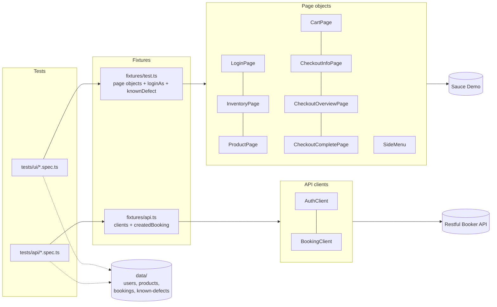
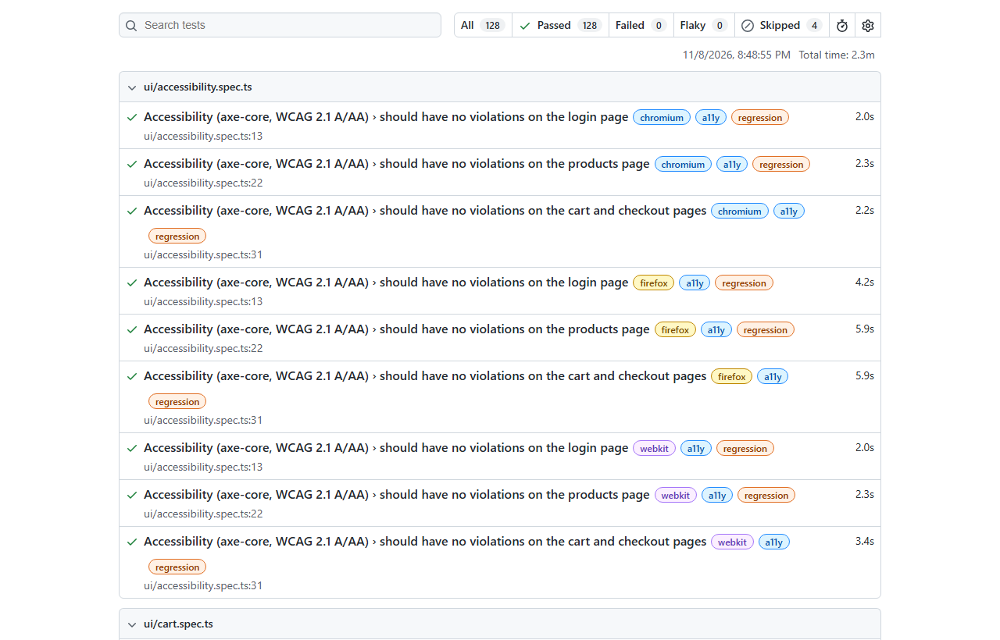

# Playwright E2E Framework (TypeScript)

An end-to-end test framework for the Sauce Demo shop with Playwright and TypeScript — Page Object Model,
custom fixtures, data-driven tests, an API layer, accessibility and visual checks — running on Chromium,
Firefox and WebKit in a GitHub Actions matrix.

[](https://github.com/the-sudipta/playwright-e2e-framework/actions/workflows/playwright.yml)
[](https://the-sudipta.github.io/playwright-e2e-framework/)
[](LICENSE)

## What this project shows

- I can build a **maintainable UI automation framework**: one page object per page, fixtures that inject them,
  test data kept apart from tests, and no fixed sleeps.
- I cover the critical journeys (login, products, sorting, cart, checkout, logout) with **positive, negative and
  data-driven** tests on **three browser engines**.
- I automate **known defects honestly**: they are `test.fail` with a link to the bug report, so the suite stays
  green while the defect exists and flags it when it is fixed.
- I add **API tests**, **accessibility checks with axe-core** and **visual comparison** to the same framework.
- I run it all in **CI** (lint → matrix → merged HTML report on GitHub Pages) with traces, screenshots and videos on failure.

## System under test and scope

| Target | URL | What is tested |
|---|---|---|
| Sauce Demo | https://www.saucedemo.com | Login (all user types), product list, sorting, product page, cart, checkout, menu, accessibility, visuals |
| Restful Booker API | https://restful-booker.herokuapp.com | Auth token, booking create / read / filter / PUT / PATCH / DELETE, negative cases |

Both are public practice applications. Tests use fake data and at most two workers.

## Tech stack

Playwright Test 1.65 · TypeScript (strict) · @axe-core/playwright · ESLint (typescript-eslint) + Prettier ·
GitHub Actions (matrix, blob reports, merge-reports) · GitHub Pages

## Architecture



## Project structure

```
playwright-e2e-framework/
├─ playwright.config.ts          # projects: chromium, firefox, webkit, api; reporters; traces/videos
├─ src/
│  ├─ pages/                     # BasePage + one class per page, components/SideMenu.ts
│  ├─ api/                       # AuthClient, BookingClient
│  ├─ fixtures/                  # test.ts (UI), api.ts (API) — the only way tests get pages/clients
│  ├─ data/                      # users, products, bookings, known-defects (links to bug reports)
│  └─ support/types.ts           # shared types
├─ tests/
│  ├─ ui/                        # login, inventory, cart, checkout, session, known-defects, accessibility, visual
│  ├─ ui/__screenshots__/        # visual baselines (Chromium)
│  └─ api/                       # auth, booking
└─ .github/workflows/playwright.yml
```

## How to run

**Windows (PowerShell)**
```powershell
powershell -ExecutionPolicy Bypass -File scripts\setup.ps1   # packages + browsers (portable Node if needed)
npm test                    # all projects
npm run test:smoke          # @smoke only
npm run test:chromium       # one browser
npm run test:api            # API layer only
npm run test:headed         # watch it run in Chromium
npm run report              # open the last HTML report
npm run lint                # ESLint + Prettier + tsc
```

**CI:** on every push, pull request and nightly: lint → one job per project (chromium, firefox, webkit, api)
→ blob reports merged into one HTML report → published to GitHub Pages. Retries (1) only in CI, with a trace
on the retry; screenshots and videos are kept for failures.

## Test coverage summary

| Area | Tests | Tags |
|---|---|---|
| Login (valid, locked out, wrong password, empty fields, close error, no session, slow user) | 8 | @smoke @negative @regression |
| Products and sorting (4 sort orders, product page) | 6 | @smoke @regression |
| Cart (add, remove, add all, cart page, continue shopping) | 6 | @smoke @regression |
| Checkout (happy path, 3 required fields, totals and tax, cancel, rounding) | 7 | @smoke @negative @regression |
| Session and menu (logout + Back, reset state, About) | 3 | @smoke @regression |
| Known defects — problem_user and error_user (`test.fail`) | 6 | @regression |
| Accessibility — axe-core WCAG 2.1 A/AA on 4 pages | 3 | @a11y |
| Visual comparison — products page and product page (Chromium) | 2 | @visual |
| **UI total** | **41 × 3 browsers** | |
| API — auth and booking CRUD / negative | 9 | @api @smoke @negative |
| **Total unique tests** | **50 (128 runs + 4 skipped visual runs)** | |

### Known defects automated as `test.fail`

| Test | Bug report |
|---|---|
| problem_user sees a different image for every product | [BUG-002](https://github.com/the-sudipta/manual-testing-case-study/blob/main/bug-reports/BUG-002-problem-user-all-six-products-show-the-same-dog-image.md) |
| problem_user can sort Z to A | [BUG-003](https://github.com/the-sudipta/manual-testing-case-study/blob/main/bug-reports/BUG-003-problem-user-sorting-the-product-list-has-no-effect.md) |
| problem_user can add all six products | [BUG-004](https://github.com/the-sudipta/manual-testing-case-study/blob/main/bug-reports/BUG-004-problem-user-add-to-cart-does-nothing-for-three-of-the-six-p.md) |
| problem_user opens the clicked product | [BUG-006](https://github.com/the-sudipta/manual-testing-case-study/blob/main/bug-reports/BUG-006-problem-user-clicking-a-product-opens-a-different-product-pag.md) |
| problem_user keeps the typed last name | [BUG-007](https://github.com/the-sudipta/manual-testing-case-study/blob/main/bug-reports/BUG-007-problem-user-typing-in-last-name-overwrites-first-name-checko.md) |
| error_user completes an order | [BUG-009](https://github.com/the-sudipta/manual-testing-case-study/blob/main/bug-reports/BUG-009-error-user-finish-button-does-nothing-the-order-cannot-be-com.md) |
| Item total has two decimals | [BUG-001](https://github.com/the-sudipta/manual-testing-case-study/blob/main/bug-reports/BUG-001-item-total-shows-an-unrounded-value-121-94999999999999-on-th.md) |

The defects were found and reported in my [manual testing case study](https://github.com/the-sudipta/manual-testing-case-study).

## Report

Live report: https://the-sudipta.github.io/playwright-e2e-framework/



## Design decisions

- **`data-test` as the test id** (`testIdAttribute`), so locators survive styling changes; role locators where
  the element has an accessible name (menu button).
- **Fixtures instead of `new Page()` in tests:** tests only ask for what they need (`inventoryPage`, `loginAs`,
  `createdBooking`); setup and cleanup live in one place. The API fixture deletes every booking it creates.
- **No fixed waits.** Page objects wait for the right page before acting — for example the overview page waits
  for its own URL because step one has a Cancel button with the same test id, which caused a WebKit race.
- **Visual checks on image regions only.** Fonts render differently on Windows and Linux; product images do not,
  so one Chromium baseline works locally and in CI.
- **Flakiness is fixed, not retried away:** retries exist only in CI and every retry records a trace.

## What I would do next

- Add authenticated storage state to skip the login UI where login is not under test.
- Add component-level visual tests with masked dynamic text.
- Run the smoke subset on every pull request and the full matrix nightly only.

## Author

**Sudipta Kumar Das** — Junior SQA Engineer (manual, API, automation) · [GitHub](https://github.com/the-sudipta)

Copyright © 2026 Sudipta Kumar Das. All rights reserved — see [LICENSE](LICENSE).
